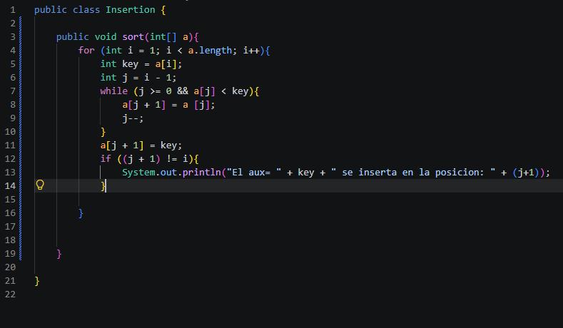

## Insertion sort

Captura del código

Explicación

Coloqué el if para poder comprobar si el número realizo un cambio de posicion, porque compara la posicion final con la inicial y solo si son diferentes entonces se va a mostrar el mensaje.

Captura de la salida
